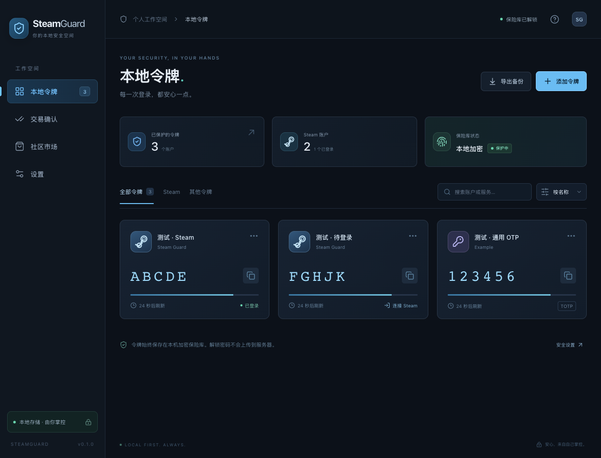

# SteamGuard

正式版安装包见 [GitHub Releases](https://github.com/lx8s8/SteamGuard/releases/latest)。Android 使用 kasen 固定发布密钥；Windows 使用 kasen 自签名证书，macOS 为 ad-hoc 签名，iOS 提供 LiveContainer IPA。签名信任范围、升级备份和安装说明见 [发布说明](docs/RELEASE.md)。


基于 Tauri 2、Rust 和 React 的本地令牌工具，从 WattToolkit / SteamTools 的本地令牌与 Steam 手机验证流程提取、改写。桌面使用侧栏布局，手机使用底部导航，适配 macOS、Windows、Android 和 iOS。

令牌在本机生成；令牌库由主密码通过 Argon2id 派生密钥，以 AES-256-GCM 加密。Steam 登录与交易确认由 Rust 调用 Steam 接口，密码不保存，登录会话只写入加密令牌库。

## 功能

- 直接导入 WattToolkit 2.x 原始 `.mpo`，支持原格式压缩、内置 AES 和二级密码；无需先转成 JSON。
- 导入 Steam `.maFile`、Steam Guard JSON、TOTP/HOTP、`otpauth://`、Google Authenticator 迁移链接和未加密 WinAuth XML。
- 显示动态验证码与剩余时间、复制、搜索、重命名、删除；提供加密备份和跨设备迁移。
- Steam 密码登录、Steam Guard/邮箱验证、二维码登录、会话续期、多个账号分别保存。
- 获取 Steam 手机交易确认，逐笔核对后接受或拒绝；查看市场挂单并打开 Steam 官方市场。
- 提供 Steam 令牌绑定、短信激活、短信转移、恢复码解绑与登录二维码审批流程。

实现范围和验证边界见 [功能矩阵](docs/feature-matrix.md)。Steam 的短信、账号限制和交易状态取决于账号与服务端；编译通过不代表已用真实账户完成交易。



图中账户及验证码均为界面测试数据，应用首次启动时没有预置账户。

## 1.1.0 手机体验与快捷访问

手机使用独立的卡片、底部导航与底部弹窗布局，扩大文字与触控区域；禁用页面手势缩放，输入框保持 16px，适配横屏、安全区和键盘。

首次升级先用主密码解锁，在「设置 → 快捷访问」中选择：

- **免密码预览令牌**：下次打开直接查看、复制验证码；登录、交易确认、导入、导出、修改、删除及 HOTP 递增仍需解锁。启用后能打开应用的人都能看到验证码，开关默认关闭。
- **指纹 / Face ID 解锁**：设备认证后进入完整保险库。Android 支持系统 Class 3 强生物认证；iOS 支持 Touch ID / Face ID。取消认证可改用主密码，更改系统生物特征后需用主密码重新启用。两项同时开启时，启动先进入只读预览，再按需解锁。

快捷密钥只保存在本机 Android Keystore / iOS Keychain，主密码不被保存。桌面版本继续用主密码。LiveContainer 中的系统认证能力取决于容器的 Keychain 与 Face ID 支持；不可用时可继续使用主密码。此功能不替代 Steam 登录所需的双重验证。

## 1.0.1 登录与双重验证修复

修复原始 MPO 的 `SteamID=0` 误报账号不一致；修正错误码 88 的提示，自动验证码失败后保留验证界面。新增“使用当前令牌验证”，提交前按 Steam 时间生成验证码。已知账号不匹配仍会拒绝绑定，缺失 SteamID 只有在本地令牌验证成功后才补全。授权账号已验证真实登录及加密保存/解锁，不需要重新导入旧备份。

## 0.1.1 登录网络修复

- 时间校准请求改为携带 `steamid=0` 的非空表单，修复真实 Steam HTTP 411 响应。
- Windows/macOS 读取系统代理；Android 通过系统 `ProxySelector` 选择代理。设置中可切换系统代理、直连、手动 HTTP/HTTPS/SOCKS5 代理。
- 增加认证接口、时间服务、社区连接检测；登录错误显示失败步骤以及 DNS、TLS、超时或代理原因，不输出账号密码或会话 URL。
- 已在本机使用授权账号完成真实密码与本地令牌验证，建立并校验 MobileApp 会话，成功只读获取确认列表；未批准或拒绝交易。Android/Windows 设备网络仍以设备上的检测结果为准。

## 开发

需要 Node.js 24、Rust 与 [Tauri 各平台前置依赖](https://v2.tauri.app/start/prerequisites/)。

```sh
npm ci
npm run tauri dev
```

普通浏览器可以运行 `npm run dev` 预览布局。实际导入、加密保存和 Steam 功能需要在 Tauri 应用中运行。

```sh
npm run check
npm run test:core -- --locked
npm run build
npx playwright install chromium
npm run test:ui
```

## 原格式导入验证

用户提供的 2024-12-04 `.mpo` 已在本机私有测试中成功读取，包含 2 条 Steam 令牌，并完成加密令牌库保存/恢复及原始 `.mpo` 再导出、再导入的往返验证。原文件及解密内容未复制进本仓库；测试不输出账号、密钥、恢复码或动态码。

如需在自己的电脑验证其他导出文件：

```sh
WATT_TEST_MPO='/absolute/path/to/private-export.mpo' npm run test:core -- real_mpo_private_import --lib -- --ignored
```

有二级密码时设置 `WATT_TEST_PASSWORD`。启用原机器保护的备份需先在原设备导出可迁移版本。MemoryPack 新格式和 WattToolkit v1 `.dat` 尚不支持，详见 [导入兼容文档](docs/import-format.md)。

已通过 24 项 Rust 默认测试和 11 项界面交互/响应式布局测试；5 项需要真实文件、网络或账号授权的测试默认跳过。另行运行的私有原文件往返测试与真实 Steam 只读 RSA 协议探测均已通过。macOS ARM64 发布 `.app`/`.dmg`、Android ARM64 调试 APK 与未签名发布 APK/AAB、iOS 未签名真机归档及模拟器 `.app` 已在本机编译成功，iOS 模拟器已完成安装启动。Windows NSIS/MSI、macOS ARM64/Intel、iOS 模拟器及真机归档的 CI 构建与产物上传均已通过，详见功能矩阵。

## 打包

| 平台 | 命令 | 产物 |
| --- | --- | --- |
| macOS | `npm run build:mac` | `.app`、`.dmg`，默认当前架构 |
| Windows | `npm run build:win` | NSIS `.exe`、MSI `.msi`，在 Windows 构建 |
| Android | `npm run build:android -- --debug --target aarch64 --ci` | 可安装的调试 APK |
| iOS 模拟器 | `npm run build:ios:sim -- --no-sign --ci` | ARM64 模拟器 `.app`，在 macOS 构建 |
| iOS IPA / LiveContainer | `npm run build:ios:ipa` | 未签名真机 `.ipa`，包含 `Payload/SteamGuard.app` |
| iOS 真机归档 | `npm run build:ios -- --no-sign --archive-only --ci` | 未签名 `.xcarchive`，不能直接安装到真机 |

LiveContainer 请下载 Actions 的 **`iOS-arm64-device-IPA-unsigned`**，先解压下载得到的外层 ZIP，再在 LiveContainer 中选择里面的 `.ipa`。`iOS-arm64-device-archive-unsigned` 是 Xcode 归档，不能直接导入 LiveContainer；模拟器包也不能用于 iPhone。IPA 结构、真机架构与未加密状态已检查，LiveContainer 内启动和插件功能仍需实机验证。

首次进行移动端开发可运行 `npm run init:android -- --ci` 或 `npm run init:ios -- --ci`。项目已包含原生工程，不必每次重新初始化。

GitHub Actions 在主分支提交、版本标签、Pull Request 或手动触发时构建桌面和移动端产物。工作流提供开发/未签名包，未配置发布证书，不自动发布商店。安装与签名细节见 [构建说明](docs/BUILDING.md)。

## 来源与许可

本项目是对 [WattToolkit / SteamTools](https://github.com/BeyondDimension/SteamTools) 本地令牌模块的独立提取与 Rust/Tauri 改写，保留 GPL-3.0 许可。格式兼容参考 BeyondDimension/Common、WinAuth、MessagePack-CSharp；具体源码位置与协议参考见 [格式文档](docs/import-format.md) 和 [Steam 集成文档](docs/steam.md)。

项目与 Valve 无隶属关系。Steam 与 Steam Guard 为其各自权利人的商标。
